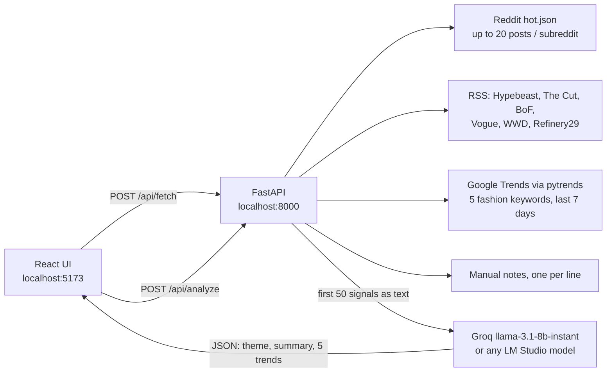

# Pulse: LLM-assisted fashion trend scouting

Pulse collects **weak signals** from fashion communities and press: Reddit hot posts, fashion RSS headlines,
Google Trends interest and your own notes. It sends them to an LLM, which returns **5 structured trend
hypotheses**. Each one has a confidence score, a momentum label, an estimated time to mainstream, a "why now" and a
suggested action. It is built for fashion buyers, stylists and trend researchers who otherwise scroll for hours.


-6D28D9)

**Demo video (5 min):** [Google Drive](https://drive.google.com/file/d/1xiQwLtt9Qdaj-13jFjtNtqp0PCRHgN9t/view?usp=sharing)

> The forecasts are **LLM-generated hypotheses**, not validated predictions. The confidence numbers and timelines
> come from the model, not from a backtest. A human should review them before acting (see [RAI.md](RAI.md)).

## How it works



- **Signals:** subreddit presets (Streetwear, Luxury, Vintage, Lifestyle) or custom subreddits, six RSS feeds,
  optional Google Trends scores, and free-text notes.
- **Analysis:** a zero-shot prompt with a fixed JSON template (temperature 0.1, max 2500 tokens). A tolerant
  parser removes markdown fences and extracts the outermost JSON object.
- **UI:** trend cards with confidence bars and momentum badges, a raw signal feed with source filters, a
  history of the runs in the current session, and export to `.txt`.

## Quick start

Requirements: Python 3.11+ and Node.js 20.19+ or 22.12+ (Vite 7). You also need **either** a free [Groq API key](https://console.groq.com) **or** LM Studio running locally.

```bash
# Backend
cd backend
pip install -r requirements.txt
uvicorn main:app --reload          # http://localhost:8000

# Frontend (new terminal)
cd frontend
npm install
npm run dev                        # http://localhost:5173
```

On Windows, `start.bat` starts both.

Then:
1. Open `http://localhost:5173` and click **Sources**.
2. Choose **Groq Cloud** and paste your key, or choose LM Studio and pick a loaded model.
3. Select subreddit presets or RSS feeds (optionally Google Trends), then click **run forecast**.

The Groq key is typed in the browser and sent to the backend with each request. It is not written to disk.
`.env.example` lists `GROQ_API_KEY` and `LM_STUDIO_URL`, but the current backend does not read a `.env` file.

## API

| Endpoint | Purpose |
|---|---|
| `GET /api/health` | Health check |
| `GET /api/sources` | Available RSS feeds |
| `GET /api/models?lm_url=` | Models loaded in LM Studio |
| `POST /api/fetch` | Collects signals: `reddit_subs`, `reddit_limit`, `rss_feeds`, `manual_text`, `use_gtrends` |
| `POST /api/analyze` | Sends the signals to the LLM: `signals`, `groq_api_key` **or** `lm_url` + `model` |

## Documentation

- [ARCHITECTURE.md](ARCHITECTURE.md): layers, data flow, business process
- [RAI.md](RAI.md): model choice, guardrails, risks, cost
- [SECURITY.md](SECURITY.md): how secrets are handled
- [CHANGELOG.md](CHANGELOG.md)
- `Pulse-AI-Powered-Fashion-Trend-Forecasting.pptx`: project presentation (28 MB)

## Limitations

- **No evaluation yet.** Nothing has been backtested to check whether predicted trends went mainstream.
- **Reddit and RSS headlines skew young, English-speaking and Western.**
- **Only the first 50 signals are sent**, in the order they were collected. They are not ranked by relevance.
- **Local tool.** CORS is open (`*`) and the backend calls whichever LM Studio URL it is given. Do not expose it publicly as is.
- Reddit's unauthenticated JSON endpoint and pytrends can rate-limit or change without notice. Failures are skipped silently.

## Roadmap

- Rank and deduplicate signals before the 50-signal cap
- Save each run, then score past predictions against later Google Trends data
- Read `GROQ_API_KEY` from the environment as an alternative to the UI field

## Team

Francis Gallo Sahayaraj (M2 AI, ECE Paris)
